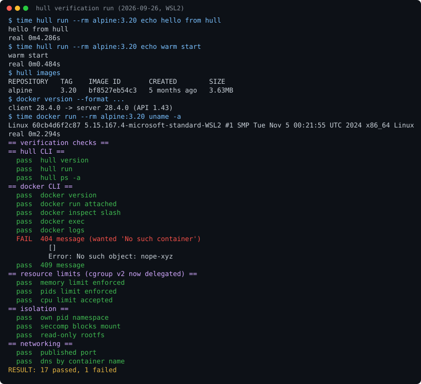

# hull

A container engine written from scratch in Go, built to replace Docker Desktop on Windows 11 + WSL2.

hull runs OCI images the way Docker does. It serves the Docker Engine API (v1.43), so clients
built for Docker (the stock `docker` CLI, `docker compose`, VS Code Dev Containers,
Testcontainers) can point at it, and it ships its own `hull` CLI and terminal dashboard on top. The container internals (namespaces,
cgroup v2, rootfs, layer store, seccomp, networking) are implemented directly against the kernel
rather than delegated to containerd or runc.

> **Status: early (0.1.0-dev).** The daily-driver path works end to end on a real WSL2 kernel:
> pull from Docker Hub, run, exec, logs, published ports, container DNS, cgroup v2 limits and
> seccomp all pass the verification run in [Results](#results). Known gaps are tracked in
> [docs/COMPAT.md](docs/COMPAT.md#gaps-found-by-running-it) and
> [docs/INTEGRATION-NOTES.md](docs/INTEGRATION-NOTES.md).

## Why not just use Docker Desktop

| | Docker Desktop | hull |
|---|---|---|
| **Idle cost** | Resource Saver pauses the engine but does not return memory to Windows on WSL | scale-to-zero: idle containers are frozen with `cgroup.freeze` and the daemon exits, letting WSL reclaim the VM |
| **Snapshots** | `docker commit` produces a new image and nothing else | `hull snapshot` / `revert` / `branch` / `diff` on a live container's overlay upper layer |
| **Isolation** | user namespaces are opt-in and awkward | per-container isolation tier (`--isolation=userns\|host\|gvisor`); `crun` available as a fallback runtime |
| **Reaching a container** | port publishing breaks in mirrored and Consomme networking modes | every published port gets a real listening socket in the root netns (what WSL's localhost relay forwards), plus DNAT for LAN traffic |

## Features

- **Docker Engine API v1.43** (accepts down to v1.24) on a named pipe (`\\.\pipe\hull_engine`) and
  a unix socket, including hijacked attach/exec, websocket attach, events, archive and filters.
- **Own runtime**: `hull-init` (PID 1 / namespace entry) and `hull-shim` (per-container supervisor
  that survives a daemon restart), with Docker's default capability set, `no_new_privs`, a seccomp
  filter, masked `/proc` paths and a read-only `/proc/sys`. `crun` can be selected per container.
- **Image store**: content-addressed store, registry client (token auth, OCI index / manifest
  lists, Range resumption), overlayfs snapshots, `save` / `load` / `push`.
- **Networking**: bridge networks, IPAM, nftables, container DNS by name, port publishing.
- **hull-only verbs**: `snapshot`, `revert`, `branch`, `lock` (pin every image to a digest in
  `hull.lock`), `sync` (two-way host folder sync with inotify), `debug` (attach a busybox toolbox
  to a distroless container), `doctor`, `ui` (TUI dashboard), and `run --explain`, which narrates
  every kernel step as it happens.
- **Coexists with Docker Desktop**: its own WSL distro, named pipe, subnet pool (`10.66.0.0/16`)
  and data root.

## Screenshots and output



Raw captures are in [docs/assets/](docs/assets/):
[verification.txt](docs/assets/verification.txt) (daemon, `hull` CLI and stock `docker` CLI),
[test-results.txt](docs/assets/test-results.txt) (`go test ./...`),
[cve-suite.txt](docs/assets/cve-suite.txt) (runc CVE regressions),
[benchmark-idutil.txt](docs/assets/benchmark-idutil.txt) and
[hull-help.txt](docs/assets/hull-help.txt).

```text
$ hull run --rm alpine:3.20 echo hello from hull
hello from hull

$ docker version --format 'client {{.Client.Version}} -> server {{.Server.Version}} (API {{.Server.APIVersion}})'
client 28.4.0 -> server 28.4.0 (API 1.43)

$ docker run --rm alpine:3.20 uname -a
Linux 60cb4d6f2c87 5.15.167.4-microsoft-standard-WSL2 #1 SMP Tue Nov 5 00:21:55 UTC 2024 x86_64 Linux
```

## Quick start

### Prerequisites

- Windows 11 with WSL2 and an Ubuntu distro for development
- Inside that distro: Go 1.26+, `make`, `nftables`, `iproute2`, `iptables`, and optionally
  `crun` for the fallback runtime
- A kernel with cgroup v2 (the default WSL2 kernel qualifies; run `hull doctor` to check)

### Build

The engine is Linux code; build it inside WSL. From Windows git-bash, `scripts/wslgo.sh` runs a
command inside the dev distro (`HULL_DEV_DISTRO`, default `Ubuntu`) from the repo root:

```bash
git clone <repo-url> hull && cd hull
./scripts/wslgo.sh 'make build'   # bin/hulld, bin/hull, bin/hull-init, bin/hull-shim (linux/amd64)
go build -o bin/hull.exe ./cmd/hull   # the Windows CLI, with Go installed on Windows
```

Inside WSL directly, `make build` does the same, and `make windows` cross-compiles `bin/hull.exe`.

### Run it locally (inside WSL, from a root shell such as `sudo -s`)

```bash
./bin/hulld --data-root /tmp/hull-data --socket /tmp/hull-data/hull.sock \
  --shim "$PWD/bin/hull-shim" --init-binary "$PWD/bin/hull-init" &

export HULL_HOST=unix:///tmp/hull-data/hull.sock
./bin/hull run --rm alpine:3.20 echo hello from hull

# the stock docker CLI works against the same socket
export DOCKER_HOST=$HULL_HOST
docker run --rm alpine:3.20 uname -a
```

### Install as the Windows engine

This path registers a dedicated `hull-engine` WSL distro. It was not part of the measured run
below, which used a daemon started by hand as shown above.

```powershell
# from a WSL shell: build binaries, the Windows CLI and the engine distro rootfs
make build && make windows && make distro

# from Windows PowerShell: register the hull-engine WSL distro
.\scripts\install.ps1
```

Then use either CLI from Windows:

```powershell
hull doctor
hull run --rm alpine echo hello
hull ui

$env:DOCKER_HOST = "npipe:////./pipe/hull_engine"
docker compose up
```

`distro/wslconfig.example` is an annotated `.wslconfig` for the engine VM.

## Usage

See [docs/CLI.md](docs/CLI.md) for the full command reference. `hull` accepts Docker's flag
spellings wherever they exist; hull-only flags are listed separately there.

```bash
hull run -d --name web -p 8080:80 nginx
hull snapshot web before-upgrade      # checkpoint the writable layer
hull revert web before-upgrade        # roll it back
hull branch web before-upgrade web2   # start a new container from the checkpoint
hull lock alpine:3.20 nginx           # write hull.lock pinning images to digests
hull run --rm --explain alpine true   # narrate every namespace, mount and cgroup write
```

## Tests and benchmarks

```bash
# unit tests (inside WSL; several packages need root for real namespaces)
./scripts/wslgo.sh 'go test ./...'
./scripts/wslgo.sh 'go vet ./...'

# micro-benchmarks
./scripts/wslgo.sh "go test -run '^\$' -bench . -benchmem ./internal/idutil/"

# integration and CVE-regression suites (root, real namespaces, build tag e2e)
./scripts/wslgo.sh 'make e2e'

# conformance: drive a running daemon with the stock docker CLI, then with hull's own CLI
DOCKER_HOST=unix:///var/lib/hull/run/hull.sock ./test/conformance/smoke.sh
./test/conformance/hull-smoke.sh
```

## Results

Measured on 2026-09-26 on a Windows 11 laptop (Intel i7-13650HX, 20 threads), WSL2 Ubuntu with
kernel 5.15.167.4-microsoft-standard-WSL2, Go 1.26.8, running as root inside WSL.

| What | Command | Result |
|---|---|---|
| Unit tests | `go test -p 4 -count=1 ./...` (after `test/fixtures/make-rootfs.sh`) | 37 packages ok, 4 without tests; 1296 tests and 2361 subtests passed, 1 skipped (an unprivileged-only path, skipped as root), 0 failed; 30.6 s wall |
| Vet | `go vet ./...` | clean |
| CVE-regression suite | `make e2e` | 13/13 passed (CVE-2019-5736, CVE-2024-21626, CVE-2025-31133 shapes, seccomp, mount escapes, pid isolation) |
| Build | `make build` | 4 static linux/amd64 binaries in 19.3 s (`hulld` 14.6 MB, `hull` 14.0 MB, `hull-shim` 4.8 MB, `hull-init` 2.5 MB) |
| Windows CLI | `go build ./cmd/hull` on Windows | `hull.exe` 15.3 MB |
| End-to-end verification | daemon + `hull` CLI + stock `docker` 28.4.0 CLI | 17 of 18 checks passed (see below) |
| Benchmark | `go test -bench . -benchmem ./internal/idutil/` | `NewID`: 287.5 / 330.3 / 309.2 ns/op over 3 runs, 160 B/op, 3 allocs/op |

Timings from the verification run (throwaway data root, image pulled from Docker Hub on first use):

| Operation | Wall time |
|---|---|
| `hull run --rm alpine:3.20 echo ...`, first run (includes the pull) | 4.29 s |
| `hull run --rm alpine:3.20 echo ...`, image cached | 0.48 s |
| `docker run --rm alpine:3.20 uname -a` against hull | 2.29 s |

The end-to-end checks cover `hull run`/`ps`, `docker run` (attached), `exec`, `inspect`, the
409 conflict message, cgroup v2 memory, pids and cpu limits, pid namespace, seccomp blocking
`mount`, `--read-only`, a published port reached from the host, and DNS by container name. The one
failing check expected `docker inspect nope-xyz` to print "No such container"; the Docker CLI's
untyped `inspect` prints "Error: No such object: nope-xyz" instead, so that check's expectation
is too strict rather than the engine being wrong.

Known flake: `TestSanitizeFDs` (`internal/runtime/initspec`) hung once until the 10-minute test
timeout in one of several full runs; it passed in every other run, including 10 back-to-back
targeted runs. The helper closes every descriptor above stderr in a Go process, including the
runtime's own, which is a likely source of the hang.

## Project layout

```
cmd/hulld          the daemon (runs inside the engine distro)
cmd/hull           the CLI and TUI (builds for linux and windows)
cmd/hull-init      the in-container PID 1 / namespace-entry stage
cmd/hull-shim      the per-container supervisor
internal/          one package per subsystem (api, engine, runtime, shim, network, oci, ...)
distro/            the Alpine engine distro's rootfs overlay and an example .wslconfig
scripts/           build-distro.sh, install.ps1, wslgo.sh
test/              CVE-regression suite (tag e2e) and docker/hull conformance scripts
docs/              architecture, CLI reference, API compatibility, roadmap, integration notes
```

## Documentation

- [docs/ARCHITECTURE.md](docs/ARCHITECTURE.md): topology, package layering, security posture and
  what has been validated on real hardware
- [docs/CLI.md](docs/CLI.md): `hull` command reference
- [docs/COMPAT.md](docs/COMPAT.md): Docker Engine API conformance checklist and known gaps
- [docs/INTEGRATION-NOTES.md](docs/INTEGRATION-NOTES.md): bugs found only by running on a real
  kernel, and how each was fixed
- [docs/ROADMAP.md](docs/ROADMAP.md): milestones

## Contributing

Issues and pull requests are welcome.

1. Build and test inside WSL (`make build`, `go vet ./...`, `go test ./...`). Keep shell scripts
   and anything under `distro/` LF-only; `.gitattributes` enforces this.
2. Anything that touches namespaces, mounts, seccomp or the layer applier should come with a test,
   and security-relevant changes should keep `make e2e` (the CVE-regression suite) green.
3. If you change a CLI verb or flag, update [docs/CLI.md](docs/CLI.md); `internal/cli` tests check
   that every documented command exists.

## Credits

The kernel primitives were learned from lizzie.io's *Linux containers in 500 lines of C*, Julian
Friedman's InfoQ Go article, Liz Rice's *containers from scratch*, rubber-docker and bocker. hull
is not a port of any of them: all five predate cgroup v2, the OCI distribution API and the recent
runc CVEs, and [docs/ARCHITECTURE.md](docs/ARCHITECTURE.md) records where their approaches are
unsafe today.

## License

[MIT](LICENSE) © 2026 Purunjay Choudhary
